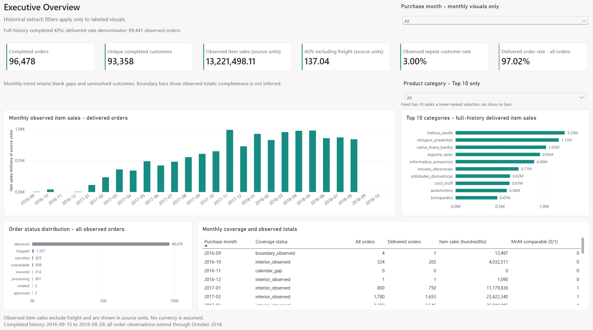
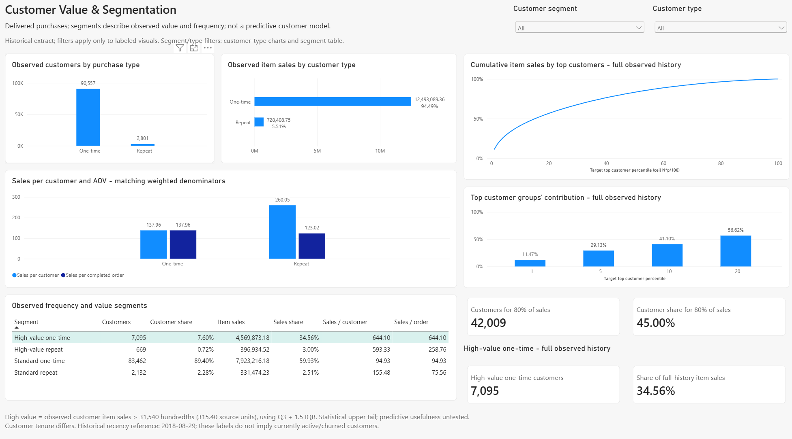
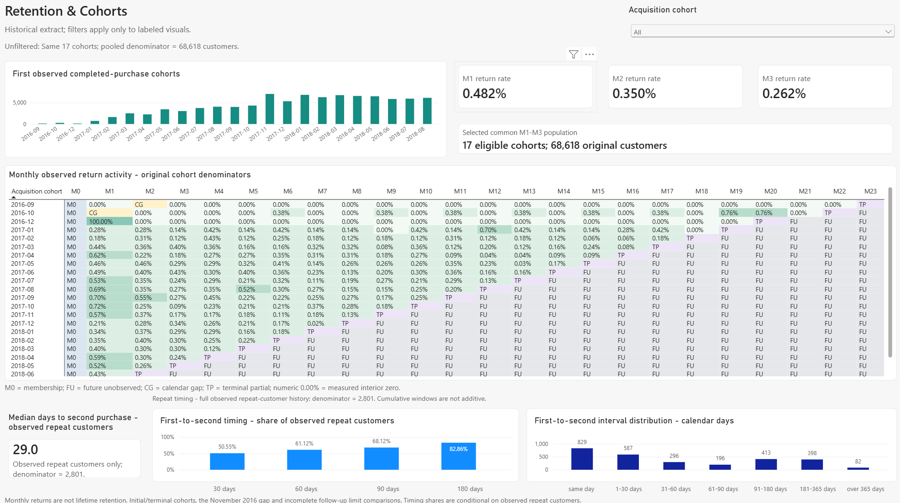
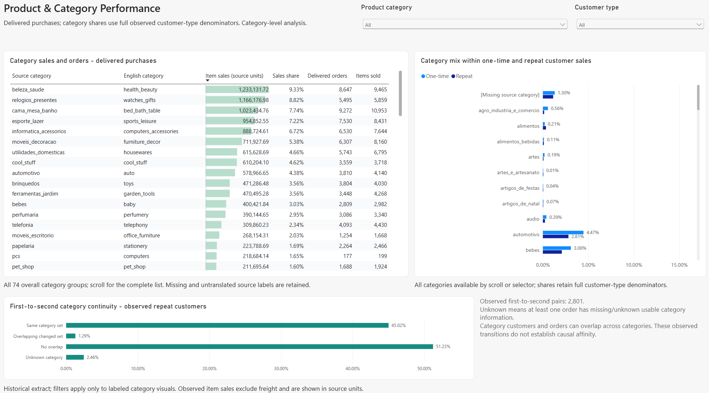

# E-commerce Sales & Customer Analytics

**Python · SQL · SQLite · Power BI | An end-to-end analytics case study for Riverside Data Analytics LLC**

## Executive summary

This project turns the historical Olist e-commerce dataset into a reproducible, validated analytical pipeline and an accepted four-page Power BI dashboard. The completed-order population contains **96,478 orders**, **93,358 unique customers**, and **13,221,498.11 source units in observed item sales**, with an **AOV of 137.04**. Only **3.00%** of customers have an observed repeat purchase, while high-value one-time customers represent **7.6% of customers but 34.56% of sales**. The work connects reliable data engineering, customer segmentation, cohort analysis, and category behavior to practical hypotheses for future business testing. Amounts exclude freight; currency is unconfirmed, and findings describe the available history.

## Business questions

- How does completed-order activity vary by month and category?
- Which customers contribute most to sales, and how do one-time and repeat purchasers differ?
- When do observed second purchases occur, and how much later-month cohort activity is visible?
- Do repeat purchases stay within the same categories or move across categories?
- Which follow-up and recommendation strategies merit controlled testing?

## Dataset

The **Brazilian E-Commerce Public Dataset by Olist** contains nine source CSVs covering orders, customers, items, payments, reviews, products, sellers, geolocation, and category translations.

- **All-order population:** 99,441 orders, with purchase timestamps from September 2016 through October 2018.
- **Completed-order population:** 96,478 delivered orders, purchased from September 15, 2016 through August 29, 2018.
- **Identity:** `customer_unique_id` identifies persistent customers; `customer_id` links order-associated customer records.
- **Coverage:** eight prepared datasets feed SQLite; geolocation is not loaded or joined.

The [source record](docs/dataset_source.md) documents the original files, archive checksum, and listed **CC BY-NC-SA 4.0** license. See the [Olist dataset on Kaggle](https://www.kaggle.com/datasets/olistbr/brazilian-ecommerce) for attribution and access. Raw files remain unchanged and are excluded from version control.

## Tech stack

- **Python / pandas:** profiling, cleaning, orchestration, exports, and independent validation.
- **SQL / SQLite:** relational storage, reusable CTEs, exact aggregations, segmentation, and cohort queries.
- **Power Query / DAX / Power BI Desktop:** typed imports, explicit measures, scoped interactions, and dashboard design.
- **unittest / SHA-256 / JSON manifests:** automated checks, reconciliation, and preservation evidence.

## End-to-end architecture / workflow

```text
Unchanged Olist CSVs
    -> Profiling and modular cleaning
    -> 8 prepared CSVs + validation manifest
    -> SQLite: 8 relational tables + 8 lossless staging tables
    -> Read-only SQL business and customer analysis
    -> 9 analytical CSVs + independent validation
    -> 9 dashboard CSVs + type/hash contract
    -> Power Query and DAX
    -> 4-page Power BI dashboard + Desktop acceptance
```

## Data engineering and validation

The pipeline preserves source lineage, removes only identical duplicate rows, retains missing values, and flags anomalies without guessing corrections. Items, payments, and reviews are aggregated independently to order grain before joining, preventing inflated totals from one-to-many joins.

Amounts use exact integer hundredths in SQL; ratios retain integer numerators and denominators. Independent Python checks rebuild expected results from base records rather than reusing the analytical SQL. CSV readbacks verify every field, and SHA-256 checks establish that protected inputs remain unchanged.

Recorded validation results:

- **118 database checks:** [database validation](reports/database_validation.md).
- **32 business metric checks and five CSV readbacks:** [business validation](reports/business_metric_validation.md).
- **28 customer checks and four CSV readbacks:** [customer validation](reports/customer_analysis_validation.md).
- **54 dashboard data checks and nine CSV readbacks:** [dashboard data validation](reports/dashboard_data_validation.md).

These analytical checks report zero failures. All four dashboard pages subsequently passed user-confirmed Desktop acceptance and final QA. The [final acceptance record](docs/powerbi_final_acceptance.md) separately discloses two pre-existing project metadata schema errors and one unreachable remote visual schema warning.

## KPI definitions

- **Completed orders:** order headers with `order_status = delivered`.
- **Unique completed customers:** distinct persistent customers with at least one delivered order.
- **Observed item sales:** item prices on delivered orders, excluding freight; not net revenue, profit, or reconciled cash.
- **AOV:** observed item sales divided by all completed orders.
- **Observed repeat customer rate:** customers with at least two completed orders divided by unique completed customers.
- **Monthly cohort return rate:** distinct customers returning in a specific later calendar month divided by their original first-observed completed-purchase cohort size.
- **Delivered-order rate:** delivered orders divided by all 99,441 observed orders; operational metrics use all statuses.

See [KPI definitions](docs/kpi_definitions.md) and [customer methodology](docs/customer_analysis_methodology.md) for exact eligibility, denominators, and coverage rules.

## Key business findings

- **Sales baseline:** 96,478 completed orders generated **13,221,498.11 source units**, with **137.04 AOV**.
- **Limited observed repetition:** **2,801 of 93,358 customers (3.00%)** have multiple completed orders; 90,557 have exactly one.
- **Value beyond repeat status:** high-value one-time customers contribute **34.56% of sales**, compared with **5.51%** from all repeat customers combined.
- **Measured concentration:** the top 20% of customers account for **56.62% of sales**. Reaching 80% requires approximately 45.00% of customers, so a literal 80/20 claim is unsupported.

The [final business findings](reports/final_business_findings.md) retain exact figures and interpretation limits.

## Customer segmentation findings

Four descriptive groups combine observed frequency and customer sales: **standard one-time (83,462)**, **high-value one-time (7,095)**, **standard repeat (2,132)**, and **high-value repeat (669)**.

High value means observed item sales strictly above the empirical Tukey upper fence, `Q3 + 1.5 × IQR`: **315.40 source units**. Threshold ties remain standard. High-value one-time customers represent **7.60% of customers and 34.56% of sales**, making this group a candidate for prospective testing.

These are descriptive segments, not predictive clusters or lifetime-value estimates. Conventional RFM quintiles were deferred because approximately 97% of customers have only one observed completed order. Historical recency uses **August 29, 2018**. See [customer findings](reports/customer_analysis_findings.md).

## Cohort / retention findings

- **Comparable monthly returns:** pooled M1 / M2 / M3 rates are **0.482% / 0.350% / 0.262%**, using the same **17 eligible cohorts and 68,618 original customers**. Each rate measures activity in that month, not cumulative retention.
- **Conditional timing:** the median first-to-second interval is **29 calendar days among 2,801 observed repeat customers**; 50.55% of that repeat population recorded a second purchase within 30 days.
- **Explicit coverage:** the 23-cohort matrix distinguishes M0 membership, measured zero, positive activity, calendar gaps, terminal partial periods, and future unobserved periods. Unavailable rates stay blank.

These results do not establish lifetime retention or an all-customer probability of repeating. Same-day second orders account for 29.60% of observed repeat customers, and 253 first/second timestamp ties limit sequence interpretation. See [customer validation](reports/customer_analysis_validation.md).

## Product/category findings

**Health & beauty** (`beleza_saude`) leads overall observed item sales at **9.33%**. It also leads the one-time customer mix at **9.43%**, while **bed, bath & table** (`cama_mesa_banho`) leads the repeat customer mix at **13.02%**.

First-to-second continuity shows substantial cross-category purchasing among **2,801 order pairs**:

- **51.23%:** no category overlap.
- **45.02%:** identical known category sets.
- **1.29%:** overlapping sets with changes.
- **2.46%:** unknown category continuity.

All **74 category groups** remain represented, including one missing-source group and two untranslated labels. Category order/customer counts overlap and are not additive. These associations do not establish category-driven repeat purchasing or recommendation effectiveness.

## Power BI dashboard

**Status: complete and accepted across all four pages.** Open [Ecommerce.pbip](powerbi/Ecommerce.pbip) in Power BI Desktop after rebuilding the dashboard data. The generated PBIX and Desktop caches are kept local and excluded from Git. The [dashboard specification](docs/powerbi_dashboard_spec.md) describes the design; the later [final acceptance record](docs/powerbi_final_acceptance.md) confirms implementation and supersedes earlier pending-build notes.

1. **Executive Overview:** completed-sales KPIs, monthly trends and coverage, Top 10 categories, and all-order status distribution.
2. **Customer Value & Segmentation:** customer-type comparisons, four segments, sales concentration, and the high-value one-time highlight.
3. **Retention & Cohorts:** acquisition sizes, comparable monthly returns, a coverage-aware matrix, and conditional repeat timing.
4. **Product & Category Performance:** complete category results, customer-type sales mixes, and first-to-second category continuity.

Nine aggregate tables are intentionally disconnected. Local slicers affect compatible visuals; full-history concentration, timing, and continuity remain fixed where documented. This preserves valid populations and denominators across analytical grains.

**Dashboard screenshots:** real captures of the four completed pages.






## Business recommendations

The evidence supports four **hypotheses to test**, rather than claimed business outcomes:

1. **High-value one-time follow-up:** revalidate eligibility on current data and compare outreach with a holdout using equal-window second-order incidence and sales per assigned customer.
2. **Post-purchase timing:** compare predefined timing arms with a control; the observed 29-day median does not establish an optimal contact day.
3. **Recommendation approaches:** test relevant cross-category and same-category recommendations against a control using a consistent assignment grain and outcome window.
4. **Comparable follow-up reporting:** separate acquisition reporting from cohort returns and display original sizes, equal observation windows, and coverage.

No intervention results or revenue lift are claimed. Current eligibility, exposure records, complete follow-up, and reliable costs are needed to evaluate incremental impact. See [business recommendations](reports/business_recommendations.md).

## Data limitations

- **Finite history:** first observed is not first ever; unequal follow-up, the November 2016 gap, and partial boundary periods limit comparisons.
- **Monetary meaning:** currency is unconfirmed. Sales exclude freight and unsupported refund, tax, discount, and profit adjustments. Payment-versus-item discrepancies remain disclosed.
- **Source quality:** lifecycle anomalies, missing metadata, unknown categories, and timestamp ties remain visible. Source timestamps have no assigned timezone.
- **Scope:** segments and transitions describe associations. Geolocation analysis is deferred, and aggregate tables do not support unrestricted joint filtering.

## Repository structure

```text
.
├── README.md
├── requirements-cleaning.txt       # Pinned, tested pipeline dependencies
├── requirements.txt                # Broader exploratory dependency list
├── data/
│   ├── raw/                        # Original archive and CSVs
│   ├── processed/                  # Prepared CSVs, profile, and manifest
│   ├── database/                   # Rebuildable olist_analytics.db
│   ├── analytics/                  # Nine analytical exports
│   └── dashboard/                  # Nine dashboard CSVs and manifest
├── src/
│   ├── profile_data.py
│   ├── cleaning/                   # Modular preparation and quality checks
│   ├── database/                   # SQLite builder and validator
│   ├── analysis/                   # SQL runners and independent checks
│   └── dashboard/                  # Dashboard preparation and validation
├── sql/                            # Schema, validation, and analysis queries
├── powerbi/
│   ├── Ecommerce.pbip              # Accepted Power BI project
│   ├── Ecommerce.pbix              # Local report file; excluded from Git
│   ├── Ecommerce.Report/           # PBIR report definitions
│   └── Ecommerce.SemanticModel/    # Model, Power Query, and DAX
├── dashboards/                     # Supporting Power Query and DAX catalogs
├── docs/                           # Definitions, methodology, spec, acceptance
├── reports/                        # Findings and validation evidence
├── tests/                          # Unit and saved-output integration checks
└── notebooks/                      # Reserved exploration folder
```

Raw, interim, processed, analytical, dashboard, and database data are excluded from version control. Generated JSON validation evidence, PBIX files, Desktop caches, logs, and local agent configuration also stay local. The repository includes PBIP source, code, reviewed Markdown reports, and dashboard screenshots. Obtain the source data and run the pipeline below to regenerate data and machine-readable evidence before refreshing Power BI.

## How to reproduce the project

Use **Windows PowerShell, Python 3.12, SQLite 3.37 or newer, and Power BI Desktop with PBIP support**. The tested Python environment is 3.12.14; SQLite is accessed through Python's standard-library `sqlite3` module.

1. Download the nine unchanged Olist CSVs into `data/raw/`, following the [source record](docs/dataset_source.md). For exact reproduction, verify the recorded archive checksum.
2. From the project root in a fresh checkout, create the environment and run the pipeline in order:

```powershell
py -3.12 -m venv .venv
.\.venv\Scripts\python.exe -m pip install -r requirements-cleaning.txt
.\.venv\Scripts\python.exe src/profile_data.py
.\.venv\Scripts\python.exe -m src.cleaning.run_cleaning
.\.venv\Scripts\python.exe -m src.database.build_database
.\.venv\Scripts\python.exe -m src.analysis.run_analysis
.\.venv\Scripts\python.exe -m src.analysis.run_customer_analysis
.\.venv\Scripts\python.exe -m src.dashboard.build_dashboard_data
.\.venv\Scripts\python.exe -m unittest discover -s tests -v
```

These commands generate data and validation artifacts. On an existing build, profiling and cleaning require `--overwrite` for intentional regeneration. Close database clients before rebuilding SQLite and run one pipeline instance at a time.

To recheck saved analytical exports without rebuilding those exports:

```powershell
.\.venv\Scripts\python.exe -m src.analysis.run_analysis --validate-only
.\.venv\Scripts\python.exe -m src.analysis.run_customer_analysis --validate-only
.\.venv\Scripts\python.exe -m src.dashboard.build_dashboard_data --validate-only
```

3. Open `powerbi/Ecommerce.pbip`. In Power Query, set **DashboardFolder** to the absolute path of your local `data/dashboard/` folder, refresh, and compare the report with the [accepted KPI baselines](docs/powerbi_final_acceptance.md). The saved parameter uses the placeholder `C:\path\to\riverside-ecommerce-analytics\data\dashboard`; replace it with your actual local folder before loading or refreshing data.

## Skills demonstrated

- Translating business questions into explicit, auditable KPI contracts.
- Building modular Python pipelines and relational SQL models with safe join grains.
- Preserving exact arithmetic, source lineage, missingness, and validation evidence.
- Analyzing customer concentration, descriptive segments, repeat timing, and observation-aware cohorts.
- Designing Power BI reports with DAX measures, clear visual hierarchy, and verified filter scope.
- Turning descriptive evidence into testable recommendations without overstating causality.
