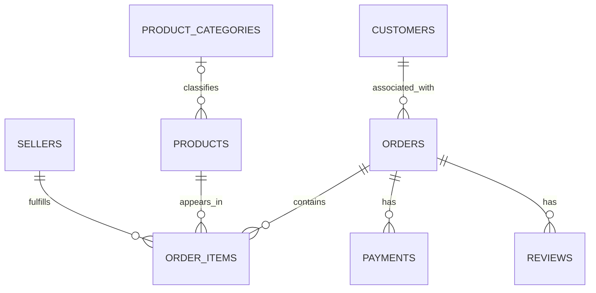

# Implemented SQLite Relational Model

Database: `data/database/olist_analytics.db`. The schema is in
[`sql/schema.sql`](../sql/schema.sql); independent reconciliation is recorded in
[`reports/database_validation.md`](../reports/database_validation.md).
The original broader proposal is superseded by this implementation of the
requested scope. Geolocation, postal lookup tables, and a separate persistent
customer entity table are deferred. No business KPIs have been calculated.

## Layers and source preservation

Eight `stg_` tables retain every parsed value from the eight processed CSVs as
TEXT, including blanks, quality flags, and source lineage: `stg_customers`,
`stg_orders`, `stg_order_items`, `stg_products`, `stg_payments`, `stg_reviews`,
`stg_sellers`, and `stg_category_translation`. This is lossless staging of the
completed processed outputs, not a raw-data reimport or rerun of cleaning.
Raw data and cleaning outputs remain untouched. Parsed record numbers do not
mean physical line numbers because reviews can be multiline. CSV quoting and
encoding bytes remain in the original protected files; staging preserves decoded
field values.

The prepared layer retains all input fields, converts missing values to SQL NULL,
stores whole numbers and flags as INTEGER, and adds exact scaled monetary columns.
It does not deduplicate, filter eligible statuses, repair chronology, fill missing
data, or choose a single review/payment per order. `ANALYZE` adds SQLite's internal
planner statistics table, not a business table.

## Tables, grain, and primary keys

- `customers`: one order-associated customer record; PK `customer_id`.
  `customer_unique_id` is nonunique TEXT, indexed for later customer-level work.
  Locations remain attached to each order-associated customer record.
- `orders`: one order; PK `order_id`; FK `customer_id` to `customers`.
  All eight source statuses and all lifecycle fields/flags are retained.
- `order_items`: one numbered item within an order; PK `(order_id, order_item_id)`;
  FKs to `orders`, `products`, and `sellers`. The item sequence is not a quantity.
- `products`: one product; PK `product_id`; nullable FK `product_category_name`
  to `product_categories`. Nullable source measurements use the prepared corrected
  `product_name_length` and `product_description_length` spellings.
- `product_categories`: one observed nonblank Portuguese label from products or
  the translation lookup; PK `product_category_name`. English names come only
  from the lookup and can be NULL. Currently 73 labels include two without
  translations; 610 products retain NULL source categories. All 71 supplied
  translations and lineage remain in `stg_category_translation`.
- `payments`: one payment sequence per order; PK `(order_id, payment_sequential)`;
  FK to `orders`. Multiple methods/sequences per order remain valid.
- `reviews`: one review/order association; PK `(review_id, order_id)`; FK to
  `orders`. Reused review IDs and multiple reviews per order remain valid.
- `sellers`: one seller; PK `seller_id`. Postal prefixes remain TEXT without a
  geographic parent requirement.



The extract has one order per customer_id. The database adds no extra uniqueness
constraint on orders.customer_id and no requirement for optional children.
Persistent customer identity links through customers.customer_unique_id; it never
replaces customer_id as the customer PK.

## Storage decisions

- Identifiers, postal prefixes, labels, and review prose are TEXT. Leading zeros
  and populated prose whitespace are preserved exactly.
- Sequences, review scores, installments, product measurements, and source record
  numbers are INTEGER. Flags are INTEGER 0/1. Nullable measurements keep missing
  values separate from zero.
- Source timestamps are strictly parsed with Python datetime and retained as TEXT
  in `YYYY-MM-DD HH:MM:SS`. Missing lifecycle stages are NULL. No timezone is
  inferred or assigned; no UTC conversion or chronology correction occurs.
- `price`, `freight_value`, and `payment_value` retain their exact decimal TEXT.
  Their INTEGER companions `price_hundredths`, `freight_value_hundredths`, and
  `payment_value_hundredths` equal the Decimal source amount multiplied by 100.
  This represents the observed scale, without asserting a currency or converting
  to an assumed currency's cents. All observed amounts fit this scale exactly.
  Fractional hundredths, nonfinite/negative amounts, or signed 64-bit overflow
  abort a future build instead of rounding.
- For exact SQL sums, use INTEGER companions and keep totals in hundredths.
  Format totals using Decimal outside SQLite. Casting original TEXT to REAL,
  SUM of decimal TEXT, or dividing by 100.0 invokes approximate binary arithmetic.
  SQLite DECIMAL/NUMERIC affinity alone does not guarantee exact decimal storage.
  Both representations are reconciled independently during build/validation;
  manual SQL edits must keep them consistent.

No new ORM or dependency is introduced. The build and validator use Python's
standard library. STRICT tables require SQLite 3.37 or newer.

## Constraints and indexes

Every prepared PK component is explicitly NOT NULL. All seven FKs use NO ACTION
on updates/deletes; each writing connection must enable `PRAGMA foreign_keys = ON`.
Required operational fields, lineage, and flags are NOT NULL; optional attributes
remain nullable. Staging is STRICT TEXT NOT NULL without uniqueness/FK/domain
constraints, preserving blank source fields.

CHECK constraints enforce flags 0/1, review scores 1-5, positive item/payment
sequences and lineage record numbers, nonnegative installments, measurements and
monetary hundredths, the eight observed statuses/five payment methods, and a
nonblank category key. Zero amounts, freight, weights, and installments are
allowed. There are no chronology checks, positive-only money rules, or
parent-must-have-child constraints. The schema and report list every constraint.

Six explicit, nonunique indexes support analytical joins:

- `idx_customers_customer_unique_id` on `customers(customer_unique_id)`.
- `idx_orders_customer_id` on `orders(customer_id)`.
- `idx_order_items_product_id` on `order_items(product_id)`.
- `idx_order_items_seller_id` on `order_items(seller_id)`.
- `idx_reviews_order_id` on `reviews(order_id)`.
- `idx_products_category` on `products(product_category_name)`.

Eight automatic unique PK indexes support the prepared keys. The leading order_id
columns of the item/payment composite PK indexes already support order joins;
redundant single-column indexes are omitted. The review PK begins with review_id,
so the separate reviews.order_id index helps. No extra UNIQUE constraints exist
on persistent customer identity, payment/review order_id, or review_id alone.

## Rebuild, validation, and analytical use

```powershell
.\.venv\Scripts\python.exe -m src.database.build_database
.\.venv\Scripts\python.exe -m src.database.validate_database
```

The builder loads parents before children inside a transaction in a unique
temporary database. It checks CSV hashes against the completed cleaning manifest,
then independently validates the temporary file read-only before replacing the
destination. Protected raw/processed hashes are compared before/after. The
validator imports neither the builder nor cleaners and compares every staged
and prepared field, counts, keys, NULL positions, exact numbers, timestamps,
category mappings, indexes, STRICT types, and FKs. Saved SQL checks also run in
any SQLite client. Markdown/JSON reports are regenerated separately from database
replacement; their database hash identifies the file checked.

Source anomalies remain with their original flags. Before future business
analysis, define eligible statuses and amounts, currency semantics, review summary
rules, and treatment of temporal anomalies. Use LEFT JOIN for optional children
and translations. Aggregate items, payments, and reviews separately to the
intended grain before joining to prevent multiplication. Geolocation awaits a
separately validated geographic layer.
